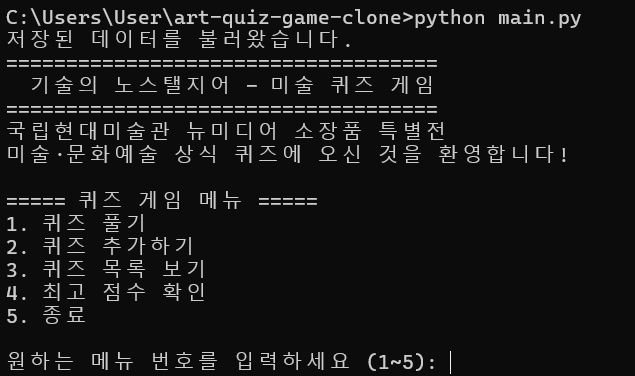
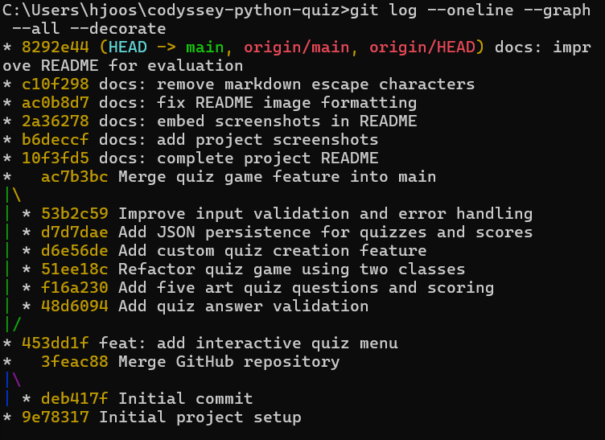

# 기술의 노스탤지어 - 미술·문화예술 퀴즈 게임


## 1. 프로젝트 개요


Python으로 제작한 터미널 기반 미술·문화예술 상식 퀴즈 게임입니다.


국립현대미술관 청주관의 뉴미디어 소장품 특별전 <기술의 노스탤지어>에서 아이디어를 얻어 제작했습니다.


사용자는 미술 작품과 작가에 관한 퀴즈를 풀고, 새로운 문제를 추가하거나 최고 점수를 확인할 수 있습니다.


## 2. 퀴즈 주제 선정 이유


평소 관심 있는 미술과 문화예술 분야를 프로그래밍 학습과 연결하고자 이 주제를 선정했습니다.


퀴즈를 직접 만들고 풀면서 미술 상식을 익히고, Python의 기본 문법과 프로그램 구조를 학습하는 것이 목표입니다.


## 3. 개발 환경


- 운영체제: Windows

- 프로그래밍 언어: Python 3.11.6

- 버전 관리: Git

- 원격 저장소: GitHub

- 외부 라이브러리: 사용하지 않음


## 4. 실행 방법


Python 3.10 이상이 설치된 환경에서 실행할 수 있습니다.


1. GitHub 저장소를 복제합니다.


```bash

git clone https://github.com/hjooshin/codyssey-python-quiz.git

```


2. 프로젝트 폴더로 이동합니다.


```bash

cd codyssey-python-quiz

```


3. 프로그램을 실행합니다.


```bash

python main.py

```


## 5. 주요 기능


프로그램을 실행하면 다음과 같은 메뉴가 나타납니다.


1. 퀴즈 풀기

2. 퀴즈 추가하기

3. 퀴즈 목록 보기

4. 최고 점수 확인

5. 종료


### 퀴즈 풀기


- 기본으로 제공되는 미술 퀴즈 5문제를 풀 수 있습니다.

- 각 문제는 4개의 선택지로 구성됩니다.

- 정답 여부를 확인하고 점수를 계산합니다.


### 퀴즈 추가하기


- 사용자가 직접 새로운 퀴즈를 등록할 수 있습니다.

- 문제, 선택지 4개, 정답 번호를 입력합니다.

- 추가한 문제는 JSON 파일에 저장됩니다.


### 퀴즈 목록 보기


- 기본 문제와 사용자가 추가한 문제를 확인할 수 있습니다.


### 최고 점수 확인


- 퀴즈 게임에서 기록한 최고 점수를 확인할 수 있습니다.

- 프로그램을 종료한 후에도 최고 점수가 유지됩니다.


## 6. 프로그램 구조

### 객체지향 설계를 선택한 이유

Quiz 클래스는 개별 문제의 데이터와 정답 판별을 담당하고, QuizGame 클래스는 전체 게임 진행과 점수 및 데이터 관리를 담당하도록 역할을 나누었습니다.

함수만으로도 프로그램을 구현할 수 있지만, 클래스를 사용하면 관련 데이터와 기능을 함께 관리할 수 있고 새로운 기능을 추가하거나 수정할 때 구조를 이해하기 쉽습니다.

다만 작은 프로그램에서는 클래스가 오히려 코드 구조를 복잡하게 만들 수 있다는 단점도 있습니다.


### Quiz 클래스


퀴즈 한 문제의 정보를 관리합니다.


- 문제 내용

- 선택지 4개

- 정답 번호


### QuizGame 클래스


퀴즈 게임 전체의 실행과 데이터를 관리합니다.


- 메뉴 출력 및 선택

- 퀴즈 진행

- 문제 추가

- 점수 계산

- 데이터 불러오기 및 저장

- 잘못된 입력 처리

### 기능별 코드 수정 위치

프로그램의 주요 기능은 main.py에 구현되어 있으며, 수정하려는 기능에 따라 다음 메서드를 확인하면 됩니다.

- Quiz.__init__() (9행): 퀴즈 문제, 선택지, 정답 데이터 초기화
- Quiz.ask() (14행): 문제 출력 및 정답 입력 처리
- QuizGame.__init__() (41행): 게임 초기 설정 및 기본 퀴즈 구성
- QuizGame.save_state() (73행): JSON 데이터 저장 방식 수정
- QuizGame.load_state() (95행): JSON 데이터 불러오기 및 오류 처리 수정
- QuizGame.add_quiz() (160행): 사용자 퀴즈 추가 기능 및 입력 검증 수정
- QuizGame.play() (203행): 퀴즈 진행 및 점수 계산 방식 수정
- QuizGame.show_quizzes() (224행): 퀴즈 목록 출력 방식 수정
- QuizGame.show_best_score() (230행): 최고 점수 출력 방식 수정
- QuizGame.run() (234행): 메뉴 구성 및 전체 실행 흐름 수정

예를 들어 퀴즈 추가 기능을 변경하려면 add_quiz()를, 저장 형식을 변경하려면 save_state()와 load_state()를 함께 확인해야 합니다.

위 줄 번호는 현재 코드 기준이며, 코드 수정에 따라 달라질 수 있습니다.

## 7. 데이터 저장 방식


Python 표준 라이브러리인 json을 사용합니다.


프로젝트 폴더의 `state.json` 파일에 사용자가 추가한 문제와 최고 점수를 저장합니다.


프로그램을 다시 실행하면 저장된 데이터를 불러옵니다.


저장 파일이 없거나 손상된 경우에도 기본 퀴즈로 시작할 수 있도록 예외 처리를 구현했습니다.


### JSON 저장 방식을 선택한 이유

JSON은 데이터를 사람이 직접 읽고 이해하기 쉬운 형식입니다. Python의 리스트와 딕셔너리처럼 여러 데이터를 구조적으로 저장할 수 있어 퀴즈 문제와 최고 점수를 관리하기에 적합하다고 판단했습니다.

또한 Python 표준 라이브러리인 json을 사용할 수 있어 별도의 프로그램이나 외부 라이브러리를 설치하지 않아도 됩니다.

이번 프로젝트는 저장할 데이터가 많지 않은 소규모 프로그램이므로 데이터베이스보다 JSON 파일을 사용하는 것이 구현과 관리 측면에서 간단하다고 생각했습니다.

### JSON 데이터 구조

state.json은 added_quizzes와 best_score라는 두 개의 주요 항목으로 구성됩니다.

- added_quizzes: 사용자가 직접 추가한 퀴즈를 리스트 형태로 저장합니다.
- question: 각 퀴즈의 문제 내용을 저장합니다.
- choices: 각 퀴즈의 선택지 4개를 리스트로 저장합니다.
- answer: 정답에 해당하는 선택지 번호를 저장합니다.
- best_score: 지금까지 기록한 최고 정답 개수를 정수로 저장합니다.

각 퀴즈는 문제 내용, 선택지, 정답을 하나의 객체로 묶어 관리합니다. 이러한 중첩 구조를 사용하면 여러 퀴즈를 추가하거나 불러올 때 각 문제의 정보를 구분하기 쉽습니다.

### JSON 저장 방식의 한계와 개선 방안

JSON 파일은 구조가 간단하고 사용하기 편리하지만, 저장할 퀴즈가 많아지면 파일 전체를 읽고 다시 저장해야 하므로 처리 시간과 메모리 사용량이 증가할 수 있습니다.

또한 여러 사용자가 동시에 같은 파일을 수정하는 상황에서는 데이터가 충돌하거나 손상될 위험이 있습니다.

향후 퀴즈 수가 많아지거나 여러 사용자가 함께 사용하는 프로그램으로 확장한다면 SQLite와 같은 데이터베이스를 도입할 수 있습니다. SQLite는 필요한 데이터를 검색하고 수정하기에 유리하며, Python 표준 라이브러리로 사용할 수 있다는 장점이 있습니다.

### 데이터 백업 및 복구 방법

프로그램을 종료한 상태에서 state.json 파일을 state_backup.json이라는 이름으로 복사하면 사용자 퀴즈와 최고 점수를 백업할 수 있습니다.

원본 state.json 파일이 손상된 경우에는 프로그램을 종료하고, 손상된 파일을 별도로 보관한 뒤 백업 파일의 이름을 state.json으로 변경하여 복구할 수 있습니다.

백업 파일이 없는 경우에는 프로그램의 예외 처리에 따라 기본 퀴즈로 시작할 수 있지만, 이전에 추가한 퀴즈와 최고 점수는 복구되지 않을 수 있습니다.

향후에는 저장 전에 자동으로 백업 파일을 생성하거나 임시 파일에 저장한 뒤 교체하는 방식으로 데이터 손상 위험을 줄일 수 있습니다.

## 8. 입력값 검증 및 예외 처리


- 메뉴에 숫자가 아닌 문자를 입력하면 다시 입력하도록 안내합니다.

- 선택 범위를 벗어난 숫자를 입력하면 재입력을 요청합니다.

- 빈 입력을 검사합니다.

- Ctrl+C 또는 EOF 입력으로 프로그램이 중단되는 경우를 처리합니다.

- JSON 파일을 읽거나 저장할 때 발생할 수 있는 오류를 처리합니다.


## 9. 프로젝트 파일 구조


```text

art-quiz-game/

├── main.py

├── state.json

└── README.md

```


- `main.py`: 퀴즈 게임 실행 코드

- `state.json`: 추가 문제 및 최고 점수 저장

- `README.md`: 프로젝트 설명서


## 10. Git 및 GitHub 활용


Git을 사용하여 기능별로 변경 사항을 기록했습니다.


주요 작업 과정은 다음과 같습니다.


1. 프로젝트 초기 설정

2. 퀴즈 메뉴 구현

3. 정답 입력값 검증

4. 기본 퀴즈 5문제 및 점수 계산

5. Quiz, QuizGame 클래스 구현

6. 사용자 퀴즈 추가 기능

7. JSON 데이터 저장 기능

8. 입력값 검증 및 예외 처리 개선


`feature/quiz` 브랜치에서 기능을 개발한 후 `main` 브랜치로 병합했습니다.


GitHub 저장소에 프로젝트 코드를 업로드하여 변경 이력을 관리했습니다.

### Git 커밋 메시지 작성 규칙

Git 커밋 메시지는 변경한 내용을 쉽게 파악할 수 있도록 기능이나 작업 목적을 중심으로 작성합니다.

앞으로는 다음과 같은 접두어를 활용하여 커밋 메시지를 일관되게 관리하고자 합니다.

- feat: 새로운 기능 추가
- fix: 오류 수정
- docs: README 등 문서 수정
- refactor: 기능 변경 없이 코드 구조 개선
- test: 테스트 코드 또는 테스트 관련 작업 추가

커밋 메시지 작성 예시:

- feat: add quiz registration feature
- fix: handle invalid user input
- docs: explain JSON storage and recovery

하나의 커밋에는 가능한 한 하나의 작업 목적을 담아 변경 이력을 이해하기 쉽게 관리합니다.


## 11. 테스트 내용


- 퀴즈 메뉴 실행 확인

- 기본 퀴즈 목록 출력 확인

- 사용자 퀴즈 추가 및 저장 확인

- 프로그램 재실행 후 저장 데이터 복구 확인

- 잘못된 메뉴 입력 처리 확인

- Ctrl+C 종료 처리 확인

- 손상된 JSON 파일 처리 테스트


## 12. 학습 소감


이번 프로젝트를 통해 Python의 함수, 클래스, 조건문, 반복문을 실제 프로그램에 적용하는 경험을 했습니다.


또한 JSON 파일을 활용한 데이터 저장과 예외 처리의 필요성을 이해할 수 있었습니다.


Git으로 기능별 변경 사항을 기록하고 브랜치를 병합하면서 버전 관리의 기본 흐름도 익혔습니다.


평소 관심 있는 미술 분야를 프로그래밍과 연결하여 직접 동작하는 프로그램을 완성했다는 점에서 의미 있는 학습이었습니다.


## 실행 및 Git 작업 화면


### 퀴즈 게임 실행 화면





### Git 커밋 및 브랜치 병합 기록




