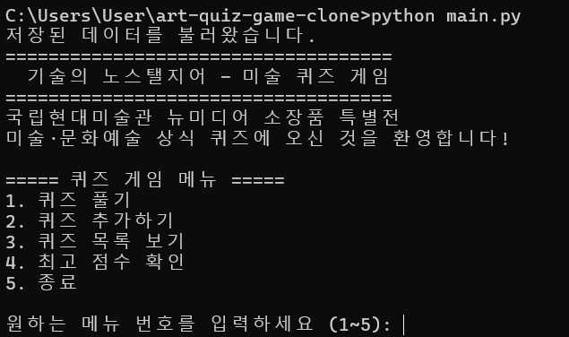
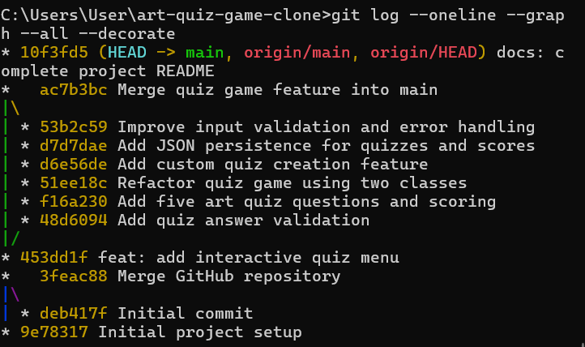

# 기술의 노스탤지어 - 미술·문화예술 퀴즈 게임


## 1. 프로젝트 개요


Python으로 제작한 터미널 기반 미술·문화예술 상식 퀴즈 게임입니다.


국립현대미술관 청주관의 뉴미디어 소장품 특별전 <기술의 노스탤지어>에서 아이디어를 얻어 제작했습니다.


사용자는 미술 작품과 작가에 관한 퀴즈를 풀고, 새로운 문제를 추가하거나 최고 점수를 확인할 수 있습니다.


## 2. 퀴즈 주제 선정 이유


평소 관심 있는 미술과 문화예술 분야를 프로그래밍 학습과 연결하고자 이 주제를 선정했습니다.


퀴즈를 직접 만들고 풀면서 미술 상식을 익히고, Python의 기본 문법과 프로그램 구조를 학습하는 것이 목표입니다.


## 3. 개발 환경


- 운영체제: Windows

- 프로그래밍 언어: Python 3.11.6

- 버전 관리: Git

- 원격 저장소: GitHub

- 외부 라이브러리: 사용하지 않음


## 4. 실행 방법


Python 3.10 이상이 설치된 환경에서 실행할 수 있습니다.


1. GitHub 저장소를 복제합니다.


```bash

git clone https://github.com/hjooshin/codyssey-python-quiz.git

```


2. 프로젝트 폴더로 이동합니다.


```bash

cd codyssey-python-quiz

```


3. 프로그램을 실행합니다.


```bash

python main.py

```


## 5. 주요 기능


프로그램을 실행하면 다음과 같은 메뉴가 나타납니다.


1. 퀴즈 풀기

2. 퀴즈 추가하기

3. 퀴즈 목록 보기

4. 최고 점수 확인

5. 종료


### 퀴즈 풀기


- 기본으로 제공되는 미술 퀴즈 5문제를 풀 수 있습니다.

- 각 문제는 4개의 선택지로 구성됩니다.

- 정답 여부를 확인하고 점수를 계산합니다.


### 퀴즈 추가하기


- 사용자가 직접 새로운 퀴즈를 등록할 수 있습니다.

- 문제, 선택지 4개, 정답 번호를 입력합니다.

- 추가한 문제는 JSON 파일에 저장됩니다.


### 퀴즈 목록 보기


- 기본 문제와 사용자가 추가한 문제를 확인할 수 있습니다.


### 최고 점수 확인


- 퀴즈 게임에서 기록한 최고 점수를 확인할 수 있습니다.

- 프로그램을 종료한 후에도 최고 점수가 유지됩니다.


## 6. 프로그램 구조


### Quiz 클래스


퀴즈 한 문제의 정보를 관리합니다.


- 문제 내용

- 선택지 4개

- 정답 번호


### QuizGame 클래스


퀴즈 게임 전체의 실행과 데이터를 관리합니다.


- 메뉴 출력 및 선택

- 퀴즈 진행

- 문제 추가

- 점수 계산

- 데이터 불러오기 및 저장

- 잘못된 입력 처리


## 7. 데이터 저장 방식


Python 표준 라이브러리인 json을 사용합니다.


프로젝트 폴더의 `state.json` 파일에 사용자가 추가한 문제와 최고 점수를 저장합니다.


프로그램을 다시 실행하면 저장된 데이터를 불러옵니다.


저장 파일이 없거나 손상된 경우에도 기본 퀴즈로 시작할 수 있도록 예외 처리를 구현했습니다.


## 8. 입력값 검증 및 예외 처리


- 메뉴에 숫자가 아닌 문자를 입력하면 다시 입력하도록 안내합니다.

- 선택 범위를 벗어난 숫자를 입력하면 재입력을 요청합니다.

- 빈 입력을 검사합니다.

- Ctrl+C 또는 EOF 입력으로 프로그램이 중단되는 경우를 처리합니다.

- JSON 파일을 읽거나 저장할 때 발생할 수 있는 오류를 처리합니다.


## 9. 프로젝트 파일 구조


```text

art-quiz-game/

├── main.py

├── state.json

└── README.md

```


- `main.py`: 퀴즈 게임 실행 코드

- `state.json`: 추가 문제 및 최고 점수 저장

- `README.md`: 프로젝트 설명서


## 10. Git 및 GitHub 활용


Git을 사용하여 기능별로 변경 사항을 기록했습니다.


주요 작업 과정은 다음과 같습니다.


1. 프로젝트 초기 설정

2. 퀴즈 메뉴 구현

3. 정답 입력값 검증

4. 기본 퀴즈 5문제 및 점수 계산

5. Quiz, QuizGame 클래스 구현

6. 사용자 퀴즈 추가 기능

7. JSON 데이터 저장 기능

8. 입력값 검증 및 예외 처리 개선


`feature/quiz` 브랜치에서 기능을 개발한 후 `main` 브랜치로 병합했습니다.


GitHub 저장소에 프로젝트 코드를 업로드하여 변경 이력을 관리했습니다.


## 11. 테스트 내용


- 퀴즈 메뉴 실행 확인

- 기본 퀴즈 목록 출력 확인

- 사용자 퀴즈 추가 및 저장 확인

- 프로그램 재실행 후 저장 데이터 복구 확인

- 잘못된 메뉴 입력 처리 확인

- Ctrl+C 종료 처리 확인

- 손상된 JSON 파일 처리 테스트


## 12. 학습 소감


이번 프로젝트를 통해 Python의 함수, 클래스, 조건문, 반복문을 실제 프로그램에 적용하는 경험을 했습니다.


또한 JSON 파일을 활용한 데이터 저장과 예외 처리의 필요성을 이해할 수 있었습니다.


Git으로 기능별 변경 사항을 기록하고 브랜치를 병합하면서 버전 관리의 기본 흐름도 익혔습니다.


평소 관심 있는 미술 분야를 프로그래밍과 연결하여 직접 동작하는 프로그램을 완성했다는 점에서 의미 있는 학습이었습니다.


## 실행 및 Git 작업 화면


### 퀴즈 게임 실행 화면





### Git 커밋 및 브랜치 병합 기록




